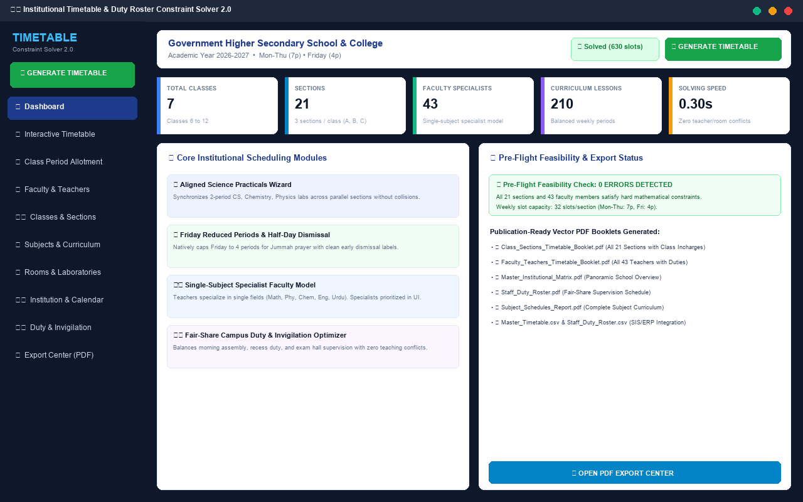
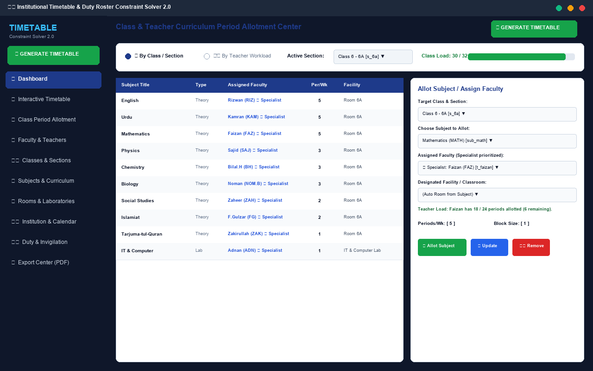
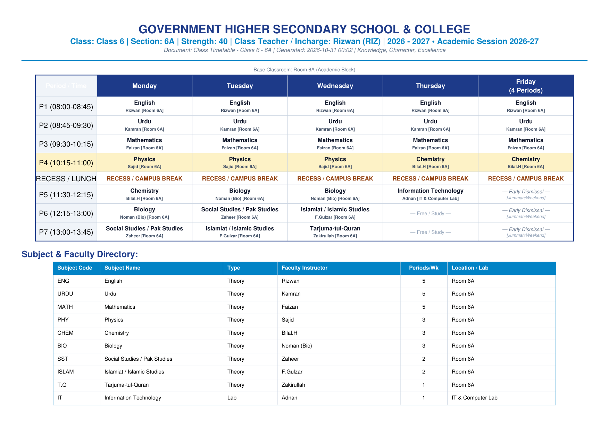
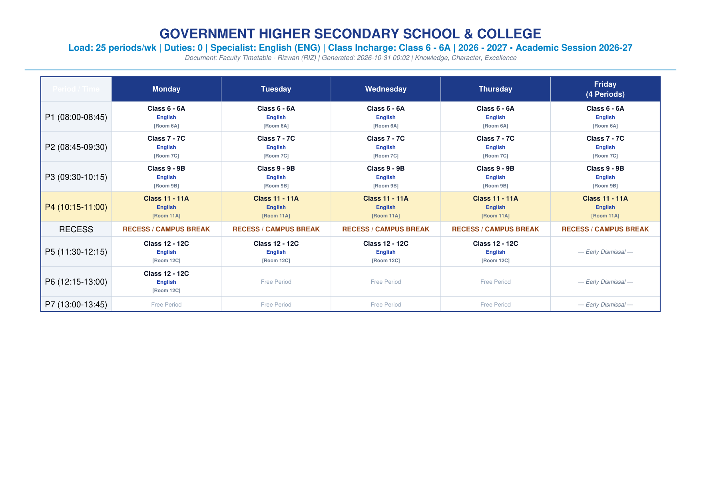
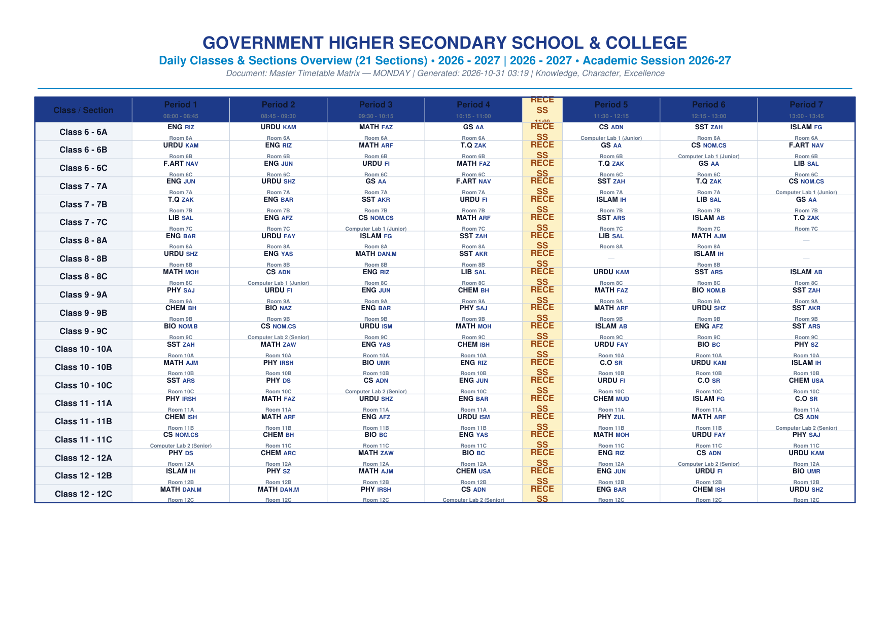
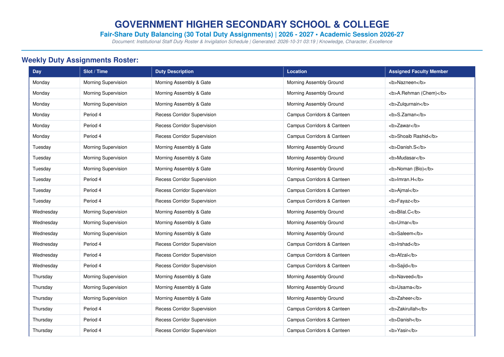

# 🏛️ Institutional Timetable & Staff Duty Roster Constraint Solver 2.0

<p align="center">
  
  
  
  
  
</p>

> **An advanced, next-generation academic timetabling and automated staff duty roster platform developed in Python 3.15 and ttkbootstrap. Solves massive multi-section institutional schedules in less than a second using native Constraint Satisfaction Programming (CSP), Minimum Remaining Values (MRV) heuristics, cognitive fatigue mitigation, and synchronized laboratory macro-tasks.**

---

## 📸 Desktop Application & Output Showcase

### 1. Modern Desktop Dashboard (Overview & 1-Click Generation)
The unified desktop suite provides a responsive navigation sidebar, real-time institutional metrics, pre-flight feasibility diagnostics, and persistent `[ ⚡ GENERATE TIMETABLE ]` buttons.



---

### 2. Dual-Mode Curriculum Period Allotment Center
Switch effortlessly between **Class View** and **Teacher Workload View**. Prioritizes subject specialists at the top of dropdowns, auto-populates specialized subjects, and monitors weekly workload quotas in real time.



---

### 3. Publication-Ready PDF Booklets & Export Reports
One-click generation of high-resolution vector PDF booklets with custom color accents, subject directories, and designated Class Incharge banners.

| 🏫 Class & Section Timetable Booklet | 👨‍🏫 Faculty Timetable Booklet |
| :---: | :---: |
|  |  |
| *Section 6A Schedule with Class Incharge, Friday early dismissal & legend* | *Teacher schedule with subject specialization & campus duties* |

| 🌐 Master Institutional Matrix | 🛡️ Staff Duty Roster & Invigilation |
| :---: | :---: |
|  |  |
| *Panoramic daily schedule sizing periods dynamically per day* | *Campus supervision and exam invigilation with min-max equity* |

---

## 🌟 Key Features & Competitive Edge

### 1. Zero Double-Booking Guarantee (Hard Constraints)
- Mathematically guarantees that no teacher, section, or classroom is scheduled for more than one class simultaneously.
- Strictly respects individual faculty unavailability matrices (part-time days, off-campus hours, personal leaves).

### 2. Parallel Practical Alignment & Combined All-Sections Sessions
- Seamlessly synchronizes practical laboratory sessions across sections (e.g., *Section A attends Computer Lab while Section B attends Chemistry Lab in the exact same time slot, and then they swap in a later slot*).
- Enforces 2-period contiguous blocks without crossing institutional recess/lunch breaks.
- **Combined all-sections sessions:** tick *Combined session* on an allocation (e.g. Counselling Officer) and one row is created for every section of that class. The solver places them all at the identical time, so the teacher appears in every section automatically.
- **Cross-grade alignment at assignment time:** multi-select existing allocations in the Align panel to run them simultaneously (e.g. 9C/10C Computer Science with 9B/10B Biology, and 11C/12C CS with 11B/12B Chemistry). Aligned groups always move together.
- **Manual swap & group-aware editing:** use *Swap Mode* to click two lectures and exchange their periods, or open any lecture to move its whole aligned group. Every manual change is validated against the full timetable and rolled back if it would double-book a section, teacher, or room.

### 3. Friday Reduced Periods & Early Dismissal
- Natively accommodates institutions with fewer periods on Fridays (e.g., 4 or 5 periods for Jummah prayer / half-day dismissal) while maintaining standard period counts (e.g., 7 or 8 periods) Monday through Thursday.
- Timetable solver strictly caps Friday schedules, and reports automatically format Friday with clear early dismissal badges.

### 4. Single-Subject Specialist Faculty Model
- Supports assigning teachers to their single specialized field (Mathematics, Physics, Chemistry, English, Urdu, IT, Biology, Islamiat, etc.).
- In the Class Period Allotment Center, specialized teachers are automatically prioritized at the top of the dropdown with a `⭐ Specialist` indicator.

### 5. Designated Class Teacher / Incharge
- Designates a specific faculty member as the official **Class Teacher / Incharge** for each section.
- Automatically displayed across interactive timetable views and printed on official booklet title banners.

### 6. Cognitive Fatigue Mitigation & Subject Dispersion (Soft Optimization)
- Evenly disperses heavy subjects (Math, Sciences) throughout the week rather than clustering them on the same day.
- Avoids late-afternoon fatigue for demanding subjects, minimizes awkward isolated idle periods for teachers, and prevents teacher burnout by enforcing maximum consecutive teaching limits.

### 7. Fair-Share Campus Duty & Exam Invigilation Roster
- Automatically schedules staff supervision (Morning Assembly, Gate Duty, Recess Monitoring, Exam Hall Invigilation).
- Strictly avoids assigning duties when a teacher has an active class.
- Balances total duties equitably across all faculty members with a tight min-max spread ($\Delta \le 1\text{ to }2$).

---

## 💡 How It Outperforms Legacy Software (e.g., aSc Timetables)

| Core Scheduling Area | Legacy aSc Timetables | Institutional Timetable Solver 2.0 |
| :--- | :--- | :--- |
| **User Interface** | Cluttered 1990s Windows dialogs, overlapping menus | Modern, responsive flat design (`ttkbootstrap` Cosmo theme) with sidebar navigation |
| **Solving Speed** | Several minutes to hours with opaque progress | Instant Backtracking + MRV + Macro-Task heuristics (solves 21 sections in **0.30s**) |
| **Lab Alignment** | Convoluted sub-menu configuration & card splits | Dedicated **Aligned Practicals Wizard** with 1-click section lab swap pairing |
| **Friday Half-Day** | Rigid dummy period workarounds | Native `friday_periods` limit with automated early dismissal labeling |
| **Teacher Specialization** | Unsorted teacher pickers | Single-subject specialist model prioritizing specialist teachers (`⭐ Specialist`) |
| **Class Teacher / Incharge** | Often unlinked from schedules | Designated Class Incharge per section, prominent on UI and PDF headers |
| **Pre-Flight Diagnostics** | Crashes or reports cryptic "unplaced cards" | Plain-English mathematical validator highlights exact bottleneck before solving |
| **Duty Roster** | Completely absent (requires external spreadsheets) | Built-in **Fair-Share Duty Optimizer** with zero teaching clashes |
| **PDF Reporting** | Pixelated monochrome tables | Publication-ready vector PDFs with typography, color badges, and legends |
| **Data Safety** | Proprietary binary format | Clean, human-readable JSON project files (`.json`) with strict data preservation |

---

## 📋 Pre-Configured Institutional Dataset Included

The repository comes pre-loaded with an institution dataset (**Government Higher Secondary School & College**):
- **7 Classes**: Class 6, Class 7, Class 8, Class 9, Class 10, Class 11, Class 12
- **21 Sections**: 3 sections per class (`6A, 6B, 6C` through `12A, 12B, 12C`)
- **43 Specialist Faculty Members**:
  - **English**: Rizwan, Junaid, Barkaat, Afzal, Yasir
  - **Urdu**: Kamran, Faisal.I, Shahzad, Ismail, Fayaz
  - **Mathematics**: Faizan, A.Rauf, Mohsin, Zawar, Ajmal, Danish
  - **Physics**: Sajid, S.Zaman, Irshad, Danish.S, Zulqurnain
  - **Chemistry**: Bilal.H, A.Rehman (Chem), Ishaq, Usama, Mudasar
  - **Biology**: Noman (Bio), Nazneen, Bilal.C, Umar
  - **Computer Science (CS)**: Adnan, Noman (IT)
  - **General Science (GS)**: Aamir Ali
  - **Counseling Officer (C.O)**: Shoaib Rashid
  - **Social Studies (SST)**: Zaheer, Akram, A.Rehman (SST)
  - **Islamic Studies / T.Q**: F.Gulzar, Imran.H, Zakirullah (T.Q), Abu.B
  - **Fine Arts & Library**: Naveed (F.Art), Saleem (Lib)
- **222 Curriculum Lessons**: Fully balanced weekly curriculum.
- **28 Classrooms & Labs**: 21 base section rooms + Junior CS Lab, Senior CS Lab, Physics Lab, Chemistry Lab, Biology Lab, Arts Studio, and Library.

---

## 🏗️ Architecture & Project Structure

```
d:\pythons\TIMETABLE\
├── main.py                     # Main Entry Point (Desktop GUI & Headless CLI)
├── README.md                   # Comprehensive documentation & visual guide
├── models/                     # Strongly-typed Object Models & Project Container
│   ├── institution.py          # InstitutionSettings, WorkingDays, PeriodTimings, Friday limits
│   ├── subject.py              # Subject, Types (Theory/Lab), Lab Needs, Fatigue Settings
│   ├── teacher.py              # Teacher, Qualifications, Workloads, Availability Matrix
│   ├── classroom.py            # Classrooms, Computer Labs, Science Labs
│   ├── section.py              # GradeClass, Multi-Section Classrooms, Class Incharge
│   ├── lesson.py               # LessonAllocation, Block Size, Aligned Synchronized Groups
│   ├── duty.py                 # DutyType, DutySlot, DutyAssignment
│   └── timetable_data.py       # Central Project Manager, JSON Persistence & Factory
├── solver/                     # Constraint Satisfaction & Optimization Engine
│   ├── validator.py            # Pre-flight mathematical feasibility & diagnostic engine
│   ├── constraints.py          # Hard/Soft constraints and penalty evaluation metrics
│   ├── timetable_solver.py     # Backtracking with MRV + Forward Checking + Macro-Task Alignment
│   └── duty_solver.py          # Fair-share Duty Roster & Invigilation Optimizer
├── exports/                    # Publication Engine
│   ├── pdf_generator.py        # Vector PDF builder (Teacher, Section, Subject, Master, Duty)
│   └── excel_exporter.py       # CSV / Excel export
├── ui/                         # Modern ttkbootstrap Desktop Interface
│   ├── app_window.py           # Main window with responsive sidebar & action ribbon
│   ├── theme.py                # Visual styling, color tokens, and badge styles
│   ├── dialogs/
│   │   ├── edit_slot_dialog.py # Interactive slot editor with live conflict detection
│   │   └── sync_group_dialog.py# Aligned Science Practicals Wizard
│   └── views/
│       ├── dashboard_view.py   # Overview metrics, system health, 1-click solve & progress
│       ├── institution_view.py # Working days checkboxes, periods per day, break timing
│       ├── teachers_view.py    # Teacher directory & interactive availability matrix
│       ├── classes_view.py     # Classes & sections management
│       ├── rooms_view.py       # Classrooms & specialized laboratory facilities
│       ├── subjects_view.py    # Subjects with color picker & fatigue settings
│       ├── lessons_view.py     # Dual-mode curriculum allocation builder (By Class / By Teacher)
│       ├── timetable_view.py   # Multi-mode grid viewer (Section, Teacher, Room, Master)
│       ├── duty_roster_view.py # Duty management & fairness distribution audit
│       └── export_view.py      # Complete PDF & CSV export control center
├── sample_data/
│   └── college_sample.json     # 21 Sections, 43 Teachers institutional database
├── docs/screenshots/           # High-resolution screenshots of UI & PDF reports
└── tests/
    └── test_timetable.py       # Automated unit test suite (100% pass)
```

---

## ⚡ Quick Start & Usage

### 1. Launch the Desktop Application
```powershell
python main.py
```

### 2. Headless CLI Batch Mode (Zero GUI / Automated Generation)
To run pre-flight diagnostics, solve the timetable, and generate all 5 publication-ready PDF booklets and CSV spreadsheets:
```powershell
python main.py --cli --export-dir institutional_exports
```

### 3. Run Automated Test Suite
```powershell
python -m unittest discover tests
```

---

## 📄 Output Booklets Overview

When running export, the system automatically compiles complete publication-ready documents on **Landscape A4 with guaranteed, balanced margins** (~35–50 pt margins, zero edge clipping):
1. `Class_Sections_Timetable_Booklet.pdf`: Complete multi-page booklet for all 21 sections with designated Class Incharge names, Period 1 locks, and home classroom indicators. Exactly 1 page per section.
2. `Faculty_Teachers_Timetable_Booklet.pdf`: Individual schedules for all 43 teachers with subject specializations, class incharge responsibilities, and campus duty commitments.
3. `Master_Sections_Matrix_By_Day.pdf` (and `Master_Institutional_Matrix.pdf`): Master schedule grouped day-by-day (Monday through Friday/Saturday). Each day is formatted on its own dedicated full-page Landscape A4 matrix showing all 21 sections across every period.
4. `Master_Faculty_Matrix_By_Day.pdf`: Master daily teacher matrix showing where every single faculty member is stationed period-by-period, their assigned campus duties, and highlighting available staff for immediate substitution.
5. `Subject_Schedules_Report.pdf`: Chronological curriculum schedule showing where and when each subject is taught.
6. `Staff_Duty_Roster.pdf`: Complete weekly duty roster with min-max fairness audit summary.
7. `Master_Timetable.csv` & `Staff_Duty_Roster.csv`: Raw spreadsheet export ready for school ERP integration.

---

## 🔒 Data Preservation Guarantee
Your database files and custom project configurations (`.json`) are **strictly preserved** and never modified without explicit user confirmation. All temporary batch runs output to dedicated export directories.
